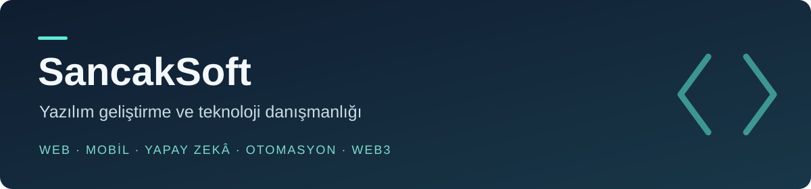

  

  <a href="https://sancaksoft.com">Web sitesi</a> &nbsp; · &nbsp;
  <a href="https://sancaksoft.com/hizmetler">Hizmetler</a> &nbsp; · &nbsp;
  <a href="https://www.linkedin.com/company/sancaksoft/">LinkedIn</a> &nbsp; · &nbsp;
  <a href="https://sancaksoft.com/iletisim">İletişim</a>

## SancakSoft hakkında

Şirketlerin iş akışlarına uygun yazılımlar geliştiriyor, mevcut sistemlerini iyileştiriyor ve teknoloji kararlarında destek oluyoruz. Web ve mobil ürünlerden yapay zekâ entegrasyonlarına kadar, ihtiyacı anlamayı teknoloji seçiminden önce ele alıyoruz.

## Neler üzerinde çalışıyoruz?

| Alan | Hizmet kapsamı |
| --- | --- |
| **Web ve SaaS** | Kurumsal siteler, portallar, yönetim panelleri ve uygulama geliştirme |
| **Mobil** | React Native / Expo ile iOS ve Android; çevrimdışı veri akışları |
| **Yapay zekâ ve otomasyon** | Doküman asistanları, RAG, bilgi tabanları ve iş akışı entegrasyonları |
| **Bulut ve DevOps** | Konteynerler, CI/CD, altyapı otomasyonu ve izleme |
| **Veri ve analitik** | Veri entegrasyonu, ETL / ELT, raporlama ve panolar |
| **Teknoloji danışmanlığı** | Mimari inceleme, kod kalitesi, bakım ve modernizasyon |
| **Blockchain / Web3** | Akıllı sözleşmeler, cüzdan entegrasyonları ve uygulama geliştirme |

**Teknik odağımız:** JavaScript · TypeScript · React · Next.js · Node.js · React Native · Python · Go · PostgreSQL · Redis · Docker

## Açık teknik çalışmalar

Bu hesaptaki seçili çalışmalar, farklı teknik yaklaşımları incelemek için bir başlangıç noktasıdır.

- **[Confirmix-Labs](https://github.com/sancaksofttech/Confirmix-Labs)** — [ConfirmixLabs/Confirmix-Labs](https://github.com/ConfirmixLabs/Confirmix-Labs) deposunun fork’u; Go ile hibrit PoA / Proof of Humanity blockchain denemesi ve Next.js arayüzü.

Depoların kapsamı ve kurulum bilgileri kendi README dosyalarındadır. Buradaki deneysel çalışmalar, canlı müşteri sistemi veya bağımsız güvenlik denetiminden geçmiş ürün olarak sunulmaz.

## Çalışma yaklaşımımız

**İhtiyacı netleştir → Mimariyi tasarla → Çalışan sürümü değerlendir → İzle ve iyileştir**

Bakım yükünü, güvenliği ve toplam maliyeti teknik kararların parçası olarak ele alıyoruz. Hazır bir çözümün uyarlanması yeterliyse, gereksiz özel geliştirmeyle kapsamı büyütmüyoruz.

---

**Bir yazılım ihtiyacınız mı var?** [SancakSoft ile iletişime geçin](https://sancaksoft.com/iletisim).

About SancakSoft · English

SancakSoft develops web, SaaS and mobile applications and provides AI integration, automation, cloud, data and technology consulting services. Our focus is practical architecture, maintainability and the total cost of building and operating software.

The repositories above include experimental projects and technical prototypes. For business enquiries, visit [sancaksoft.com](https://sancaksoft.com).

